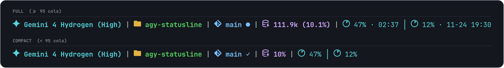

# agy-statusline

A fast, zero-dependency native status line for [Antigravity CLI](https://antigravity.google/docs/cli/statusline/), written in Zig.



## Features

- **Instant startup**: ~449 KB native binary on macOS with zero runtime dependencies and zero network requests (~3.6 ms minimal, ~11 ms full with Git).
- **Model-aware quota**: Automatically tracks 5-hour and weekly usage (`5h │ weekly`) with local-timezone reset times for Gemini and third-party models (Claude, GPT, etc.).
- **Git awareness**: Shows current branch or short commit SHA alongside clean (`✓`) / dirty (`●`) state.
- **Context telemetry**: Displays token usage (`k` / `M`) and context window percentage.
- **Responsive layout**: Automatically switches to a compact format below 95 columns.

## Segments

| Segment | Full (`>= 95 cols`) | Compact (`< 95 cols`) |
| --- | --- | --- |
| Model | Display name | Display name |
| Workspace | Current directory name | Current directory name |
| Git | Branch / short SHA + `●` or `✓` | Branch / short SHA + `●` or `✓` |
| Context | Tokens + percentage (`111.9k (10.1%)`) | Percentage (`10%`) |
| Quota | 5h + weekly `%` + reset time (`47% · 02:37 │ 12% · 11-24 19:30`) | 5h + weekly `%` (`47% │ 12%`) |

## Install

Requires a [Nerd Font](https://www.nerdfonts.com/) and optional Git.

**macOS / Linux:**

```sh
curl -fsSL https://raw.githubusercontent.com/what1f/agy-statusline/main/install.sh | sh
```

**Windows (PowerShell):**

```powershell
irm https://raw.githubusercontent.com/what1f/agy-statusline/main/install.ps1 | iex
```

The installer downloads the prebuilt binary to `~/.gemini/antigravity-cli/` and updates `settings.json` (prompting before overwriting an existing `statusLine` configuration; pass `-s -- --yes` on macOS/Linux or set `$env:AGY_STATUSLINE_YES=1` on Windows to overwrite non-interactively).

<details>
<summary>Build from source (requires Zig 0.17.0)</summary>

```sh
git clone https://github.com/what1f/agy-statusline.git
cd agy-statusline
./install.sh --from-source      # macOS / Linux
# .\install.ps1 -FromSource     # Windows (PowerShell)
```

Or activate manually inside Antigravity CLI:

```text
/statusline ~/.gemini/antigravity-cli/statusline
```

</details>

## Preview

```sh
printf '%s\n' '{"model":{"display_name":"Gemini 4 Hydrogen (High)"},"workspace":{"current_dir":"."},"context_window":{"used_percentage":10.1,"current_usage":{"input_tokens":111900}},"quota":{"gemini-5h":{"remaining_fraction":0.53,"reset_in_seconds":7200},"gemini-weekly":{"remaining_fraction":0.88,"reset_in_seconds":432000}}}' | ~/.gemini/antigravity-cli/statusline
```

## License

[MIT](LICENSE)
